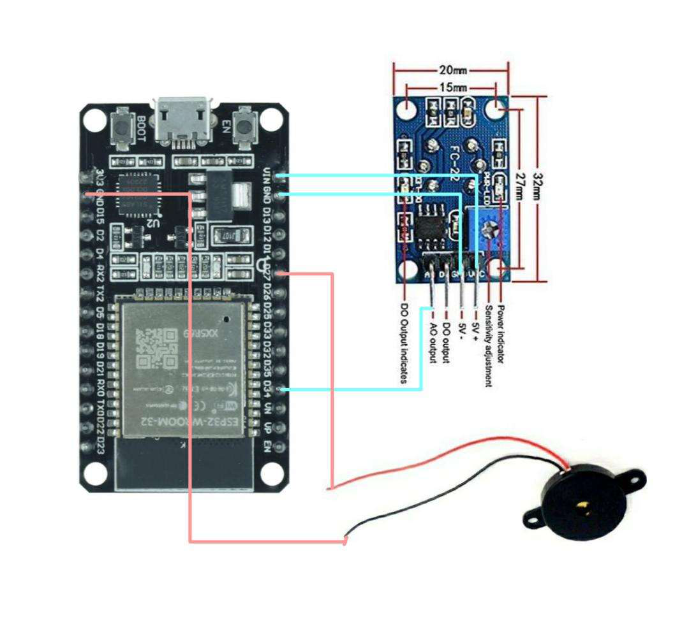

# 🧪 IoT-Based Gas Detection & Alert System

**CSC4700-1 – Embedded System Development (Assignment 1, Group 4)**
Universiti Putra Malaysia (UPM)

📄 **Full report:** [`docs/CSC4700 Assignment 1 Report.pdf`](docs/CSC4700%20Assignment%201%20Report.pdf) (IoT design methodology, testing and results, 29 pages)

## 📌 Project Overview

This project is a **prototype IoT-based gas detection and alert system** for **chemistry laboratories, chemical storage rooms and small warehouses**. It monitors air quality, detects abnormal gas conditions, sounds a **local buzzer alarm**, and provides **remote monitoring and notifications** through a Blynk IoT dashboard.

The prototype shows how **low-cost embedded hardware and an IoT platform** can improve safety by detecting hazards early and reducing reliance on manual inspection.

> ⚠️ **Real vs simulated sensing**
> Only general air quality is physically sensed, by the MQ-135. The individual gas concentrations (CO, CH₄, NH₃, H₂S, NO₂) are **software-simulated** to demonstrate multi-gas detection logic. This is a prototype, **not a certified safety device**.

---

## 🎯 Objectives

* Monitor laboratory air quality using an embedded gas sensor
* Demonstrate **multi-gas monitoring logic** using software-simulated gas values
* Trigger **local audible alerts** when unsafe conditions persist
* Enable **remote real-time monitoring** via the Blynk IoT platform
* Log sensor data for historical analysis
* Design a **low-cost, scalable IoT safety prototype**

---

## 🧠 System Architecture

* **Edge node:** ESP32 microcontroller (all detection logic runs here)
* **Sensing:** MQ-135 gas sensor (general air quality, analog output)
* **Actuation:** piezo buzzer for local alerts
* **Cloud platform:** Blynk IoT (dashboard, data logging, push notifications)
* **Connectivity:** Wi-Fi (IEEE 802.11)

---

## 🔧 Hardware

| Component                 | Description                     |
| ------------------------- | ------------------------------- |
| ESP32 Dev Module          | Main controller and IoT gateway |
| MQ-135 gas sensor module  | General air quality sensing     |
| Piezo buzzer              | Local audible alert             |
| Breadboard & jumper wires | Prototyping                     |
| USB power supply          | Power source                    |

### Wiring



| Connection             | ESP32 pin               |
| ---------------------- | ----------------------- |
| MQ-135 AO (analog out) | GPIO 34 (`MQ135_PIN`)   |
| MQ-135 VCC             | VIN (5 V)               |
| MQ-135 GND             | GND                     |
| Buzzer +               | GPIO 27 (`BUZZER_PIN`)  |
| Buzzer −               | GND                     |

> ⚡ The ESP32 ADC is rated for at most 3.3 V. With the MQ-135 module powered from 5 V, its analog output can rise above that in strong gas, so a voltage divider on AO is safer.

---

## 💻 Software & Tools

* **Arduino IDE** with the **ESP32 board package 3.x** (the code uses the 3.x `ledcAttach` API)
* **Blynk** library (`BlynkSimpleEsp32.h`)
* **C/C++ (ESP32 firmware)**
* **Blynk IoT** platform (web and mobile dashboard)

The sketch compiles with `arduino-cli` for **ESP32 Dev Module** (board package 3.3.5).

---

## 🔄 How It Works

### Physical sensing (MQ-135)

1. **Warm-up:** the first 2 minutes after power-on are ignored while the sensor heats up.
2. **Baseline:** for the next 1 minute, readings are averaged into a baseline for the room.
3. **Monitoring:** every **5 seconds** the reading is compared with the baseline. An **alarm** is raised when it is above **baseline × 1.30 for 3 consecutive samples** (about 10–15 s of sustained change), which filters out brief spikes.

### Simulated gases (scenario switches)

| Switch | Scenario          | Simulated gases rising | Alarm threshold                 |
| ------ | ----------------- | ---------------------- | ------------------------------- |
| V10    | Combustion event  | CO, NO₂                | CO > 50 ppm or NO₂ > 3 ppm      |
| V11    | Gas line leak     | CH₄                    | CH₄ > 5,000 ppm                 |
| V12    | Chemical spill    | NH₃, H₂S               | NH₃ > 25 ppm or H₂S > 10 ppm    |
| V13    | Toxic gas release | H₂S                    | H₂S > 10 ppm                    |

* Turning a scenario switch **on** starts it in the **WARNING** stage and the gas values accumulate every second.
* When any threshold is crossed it escalates to **ALARM**: the buzzer sounds and a Blynk notification is sent.
* Turning the switch **off** acknowledges the alarm and resets to **NORMAL**.
* With no scenario active, the simulated gases show safe background values with a little noise.

### Alerts

* **Buzzer:** on during ALARM (3 kHz tone), off in WARNING and NORMAL. The **Mute** switch (V21) silences it.
* **Notifications:** a Blynk event (`gas_alert`) is logged once for WARNING and once for ALARM.
* **Auto demo** (V20): cycles through the four scenarios every 20 seconds.

---

## ☁️ Blynk Setup

1. Create a Blynk template and fill in `BLYNK_TEMPLATE_ID`, `BLYNK_AUTH_TOKEN`, `ssid` and `pass` at the top of `gas-sensor/gas-sensor.ino`. **Do not commit these values.**
2. Create these datastreams:

| Pin     | Datastream                     | Type                 |
| ------- | ------------------------------ | -------------------- |
| V0      | Air quality (MQ-135 raw 0–4095) | Integer             |
| V1–V5   | CO, NH₃, CH₄, H₂S, NO₂ (ppm)    | Double              |
| V6      | Scenario name                  | String               |
| V7      | Alarm status (NORMAL / WARNING / ALARM) | String      |
| V10–V13 | Scenario switches              | Integer (switch 0/1) |
| V20     | Auto demo                      | Integer (switch 0/1) |
| V21     | Mute                           | Integer (switch 0/1) |

3. Add an event with the code **`gas_alert`** and enable notifications for it.
4. Upload the sketch and open the serial monitor at **115200 baud** to see the baseline and event messages.

---

## 📊 Features

* ✅ Continuous air quality monitoring with an automatic baseline
* ✅ Sustained anomaly detection (reduces false alarms)
* ✅ Local audible alerts with mute
* ✅ Remote monitoring and push notifications
* ✅ Manual scenario switches and an automatic demo mode
* ✅ Cloud data logging for history graphs

---

## 📈 Results Summary

From testing in a controlled indoor setting, exposing the MQ-135 to smoke and alcohol vapour and running the simulated scenarios (see the report):

* The buzzer and push notification fired within **about 5 seconds** of gas levels crossing the thresholds
* Test exposures showed as clear spikes on the Blynk history graphs, and alerts cleared when levels returned to normal
* Data reached the Blynk cloud reliably, and remote users received and acknowledged alerts
* Operation was stable across several test sessions, with automatic recovery from short Wi-Fi outages

> This prototype validates the feasibility of IoT-based laboratory gas monitoring using affordable hardware.

---

## ⚠️ Limitations

* The MQ-135 cannot distinguish specific gas types, and it is not calibrated to ppm
* The individual gas readings are **software-simulated**
* `Blynk.begin()` waits for Wi-Fi and Blynk at start-up, so the device does not start monitoring if the network is unavailable when it powers on
* Prototype only; **not a certified safety device**

---

## 🚀 Future Improvements

* Add dedicated gas sensors (MQ-7, MQ-4, MQ-136, etc.)
* Perform real gas calibration and laboratory testing
* Start monitoring and local alarms without waiting for Wi-Fi
* Add battery backup and offline buffering
* Support MQTT-based communication
* Deploy multiple sensor nodes

---

## 📁 Repository Structure

```
├── gas-sensor/
│   └── gas-sensor.ino                    # ESP32 firmware
├── docs/
│   ├── CSC4700 Assignment 1 Report.pdf   # full report
│   └── images/wiring.png                 # wiring diagram
└── README.md
```

---

## 👥 Team Members (Group 4)

* Adibah Nawal Binti Muhammad Lukman
* Filzah Irdina Binti Ramdan
* Nurul Izzah Mardhiyyah Binti Mahmud
* Sharifah Hana Maisarah Binti Syed Omar
* Fatin Nurmaryam Binti Khairul Arifin
* Nur Farzana Alya Binti Saharudin

---

## 🏫 Course Information

* **Course:** Embedded System Development (CSC4700-1)
* **Lecturer:** Ts. Dr. Raihani Binti Mohamed
* **Institution:** Universiti Putra Malaysia

---

## 📜 License

This project is developed **for academic purposes only**.
